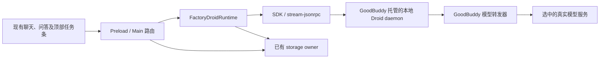

# Factory Droid Runtime 技术设计

## 方案决定

采用一个 `factory-droid` provider，通过官方 SDK 原生接口承载会话；后台任务管理采用
已经验证的本地 daemon 公开会话接口。CLI `stream-jsonrpc` 保留为协议验证与对照路径。
进程启动、配置、凭据和资源释放由 GoodBuddy 管理，不访问 SDK 私有字段。
同一个产品对话使用一个原生 session，不同时启动 ACP 与 native 来拼接功能。

选择依据：`droid 0.245.1` 与 `@factory/droid-sdk 0.10.0` 已通过原生问答及文本增量验证。
此前 ACP 通过基本会话但未完成这两项。本地协议握手版本不同仍可运行已测方法，不等于完整
协议兼容；SDK 与二进制须按已验证组合管理，能力检查失败要明确报错。

本方案实现[产品需求](./prd.md)和[状态设计](./logic-design.md)。
事实、请求次数与未测项只在[验证进度](./progress.md)维护。

## 进程与模型



本地 daemon 已测启动形态：

```text
droid daemon --host 127.0.0.1 --port <allocated-port>
  --droid-path <installed-droid> --settings <managed-settings>
```

子进程设置 `FACTORY_AIRGAP_ENABLED=1`、`FACTORY_DROID_AUTO_UPDATE_ENABLED=0`、
`FACTORY_DISABLE_SETTINGS_PERSISTENCE=true`，使用隔离 `FACTORY_HOME_OVERRIDE`，其值是
`.factory` 的父目录。通过 SDK initializeSession 传入 cwd、runtimeSettingsPath 和模型。
本地 websocket authenticate 在 Airgap 测试中接受合成 token，不需要 Factory 云端登录；
这不证明 token 是实际访问控制。产品须保持回环绑定并核对现有本机进程通信边界，不能把该
测试 token 复用为远程认证方案。daemon 的问答/Skills/MCP 产品组合仍须独立回归。
`--settings` 合并配置不能单独提供隔离保证；用户配置来源、Hooks、插件及 MCP 必须验证。
测试采用的 HOME/USERPROFILE 全量重定向不能未经验证直接照搬产品，否则 Git/SSH 等用户
开发环境可能失效。产品优先隔离 Factory 目录，保留正常执行账号环境，并验证加载来源。

按已有模型继承规则解析 profile，将协议、模型名、上下文、输出限制、请求头及 body 配置
映射到 managed custom model。使用 Droid 返回的模型 ID，不硬编码 `custom:...-0`。
加载会话后重新核对模型。初步协议映射：Responses → `openai`、Chat Completions →
`generic-chat-completion-api`、Messages → `anthropic`；仅 Responses 已实测，另外两项
须通过验收后才标记支持。图像生成 profile 不可作为文本 Runtime 模型。

本地模型转发器使用现有 Electron 网络栈及凭据边界；Main 注入真实凭据，Droid 仅获得
受控回环入口。扩展现有网关实现，禁止复制一套凭据存储。密钥不写 Renderer、会话或
普通配置文件。转发器由会话执行 owner 持有，有后台工作时不能随父 turn 关闭。

2026-10-25 起按[应用市场交付方向](../../design/marketplace-delivery.md)规划：Droid 运行资源
通过市场下载或手动导入，SDK 与二进制固定为已验证组合。SDK 随可选资源还是必要适配代码
构建，在打包验证后确定，替代此前固定随主包构建的假设。启动会话时不执行 npm 安装；
验证脚本临时下载 SDK 只用于调研。离线资源须具备运行依赖，交付范围见
[安装与分发](./prd.md#安装与分发)。

托管安装按 Host、平台、架构和精确版本复用现有 artifact 管理方式。下载源在一次操作开始
时确定，保留不可变 URL、字节大小与摘要；原站和镜像必须字节一致，失败明确显示，不能自动
切换来源。优先复用应用现有 artifact 下载源设置，是否需要独立 Droid 设置在正式接入时
核对；当前没有新增设置。离线导入核对平台、版本及摘要，不执行在线依赖安装。
版本释放遵循现有进程 owner，不为每个项目复制二进制，也不删除用户提供的原文件。

## 复用与改动位置

| 位置 | 需要的窄范围改动 |
| --- | --- |
| `src/shared/contracts.ts`、`runtime-selection-contracts.ts` | provider、状态、解析选择及模型继承；消除增加 provider 后落入其他 Runtime 的默认分支 |
| `src/shared/capability-contracts.ts` | 增加分配目标，数组长度从目标列表派生，替代固定 `.max(4)` |
| `src/main/agent/create-runtime.ts`、`runtime-selection.ts` | 显式创建 Droid 适配器，传入现有模型、工具及输出 port |
| `src/main/agent/runtime.ts` | 增加 Droid 用量归属、可选会话事件订阅和明确的后台任务控制操作 |
| `runtime-controller.ts`、`local-runtime-registry.ts` | 旧配置实例等待所属后台工作结算；持有会话级问题及事件路由 |
| `src/main/ipc.ts`、现有 Preload 合同 | 后台状态、输出和停止按所属会话/任务路由；控制操作不占新的模型执行槽 |
| `src/main/assistant/assistant-database.ts` | 扩展原生后台任务关联和提交操作；父终态不误结算会话级任务 |
| `desktop-storage-runtime-operations.ts` | 在现有 binding owner 增加本地会话关联，不伪造远程 Host 元数据 |
| `task-store.ts`、`task-selectors.ts`、`task-sync.ts` | 任务级增量订阅、会话筛选；不逐块 `refreshTasks()` |
| `ConversationHistorySlot.tsx`、`agent-event-handler.ts` | 顶部后台条、迟到事件归属及后台终态处理；复用已有问答 UI |

新增的 `FactoryDroidRuntime` 保持一个适配器，不新建通用 scheduler、独立任务数据库或
另一套问答状态。数据库结构变更遵循[迁移指南](../../../development/database-migrations.md)，
业务 SQL 仍由 storage utility owner 执行。

## 原生事件映射

CLI 原生通知为 `droid.session_notification`，daemon 为 `daemon.session_notification`，
正文在 `params.notification`。daemon 可按 params.sessionId 分流；部分 CLI 工具通知没有
sessionId，使用连接所属会话补齐。
SDK partial stream 映射后的字段与原始通知字段不同，适配层应固定一种入口完成归一化。

| 原生输入 | GoodBuddy 映射 |
| --- | --- |
| `assistant_text_delta` | 文本增量；按消息/块身份累计，最终完整消息只核对和补缺，不重复追加 |
| `tool_call` / `tool_result` / progress | 现有工具活动、原生调用 ID、预览及输出引用 |
| `token_usage_update` | 现有用量 ledger；核对累计量与单轮量，不能同时重复入账 |
| `droid.ask_user` | 现有 question 事件与异步 handler，保留原生题目 index 和 question |
| `child_session_available` | 关联 childSessionId、toolUseId、subagentType、description |
| `agent_turn_completed` / result | 结算所属前台 turn，不推导所有子任务终态 |
| TodoWrite + 成功 tool_result | 从完整 `toolUse.input.todos` 的编号状态行构建 checklist，按 toolUseId 关联；忽略初始空输入 |

`run()` 只承载前台 turn，正常结束必须释放前台调度。会话订阅接收 turn 结束后的后台事件。
在适配器内按事件身份分流，避免同一个事件从 stream 和 subscription 重复发送。
后台事件携带固定 conversation/task/binding 关联，不依赖 Renderer 当前选中项。
Todo 的 pending/in_progress/completed 已与现有状态对应，接入需增加 Droid source。
恢复可从原生工具历史重建最后一次成功 Todo；不推断未验证的 priority 或 cancelled。
后台完成触发的 task-completion turn 必须保留原生 turnId，不能误结算其他前台请求。

## 用户问答

使用 `askUserHandler` 等待 GoodBuddy 的 `respondToQuestion`。本机工具目录中的 `AskUser`
默认不可用，实测需要通过 native `updateSettings` 显式启用后才能调用。实现同时验证工具
启用和 handler 注册，不能只做前端卡片。

用户问题沿用现有 `LiveAgentQuestion`、`AgentQuestionCard`、回答 IPC 与历史记录。
Main/controller 的 question owner 从“仅属于 request”扩展为可属于会话后台任务，不能在
父 `run()` 的 finally 中无条件清除。多选、自定义答案和跳过按状态设计完成验证。

普通权限回调按账号权限和 GoodBuddy 启用能力执行，不增加产品审批模式。用户问题必须真实
等待用户，不能自动选第一项。对后台子会话的问答，还须验证 handler 的归属及重新挂载方式。

## 后台任务与控制通道

后台子代理 `Task` 的输入包含 `await`、`resume`，`await=false` 对应异步启动；后台命令
`Execute` 使用 `fireAndForget`，是另一种任务类型，不能把 PID 当成子会话 ID。

已有 assistant task 存储保留 task kind、执行生命周期及原生关联。父请求关联用于追溯，
会话级 lifecycle 决定它是否能在父请求结束后继续。原有前台子任务行为保持原语义。

以下区别决定控制接口实现：

- `TaskOutput`、`TaskStop` 是模型工具，不是已经存在的同名客户端 RPC。顶部按钮不能通过
  额外发一次模型 Prompt 才执行停止。
- `droid.kill_worker_session` 有 Mission 语义，会影响 worker/orchestrator。不得拿它充当
  普通 Task 的独立停止。
- `droid.load_session` 能提供消息快照和 `subagentInvocations`，但会切换 client 当前会话。
  仅用于恢复或空闲时检查，不能在父流执行中用同一个 client 轮询子任务。
- SDK daemon 的 `getSessionMessages`、`loadSession`、`listOpenedSessions` 和
  `interruptSession({sessionId: childId})` 已验证可用于独立读取、附加及停止普通 Task；
  目标 cancelled 时父回复和兄弟任务继续。daemon-only 方法不能发给 CLI。

普通子代理管理通道已确定采用 daemon。后台 Shell 的 PID/log 需要单独控制合同，当前只
验证输出和自然结束，尚未验证定向停止。产品采用 daemon 后仍需将 CLI 已通过的问答、
Skills/MCP 与 daemon 组合复验；不把两个入口分别通过视为整个产品组合已通过。

## Skills 与 MCP 配置

验证已覆盖项目 Skill 优先级、用户回退、禁用/恢复及工具实际执行。GoodBuddy 按能力分配
生成隔离资源，保持原 Skill 文件和脚本的相对路径。真实模型已加载 Skill 并使用其指令
调用 MCP；模型自主选择并执行 Skill 脚本还需补测。

stdio/HTTP MCP 连接、工具调用、合成鉴权、错误、取消和工作区隔离已测试。延迟工具需
ToolSearch，原生 MCP 工具 ID 使用 server___tool，映射时保留原始 ID。
GoodBuddy 的 MCP 启停及 Runtime 分配以现有全局设置为权威来源，不增加项目级 toggle。
全局变更应同步到受影响的 Droid 实例；每个实例在隔离 Factory home 中使用原生 User scope
应用配置，不能借此修改用户真实 Factory 全局设置。这里的 User scope 是 Droid 的配置
写入方式，不是 GoodBuddy 新增的设置层级。验证还需覆盖多个已运行会话同步禁用、随后新建
会话继承状态，以及重新启用后的恢复。

禁用后工具和进程已撤销，但当前会话状态仍可能在观察窗口内停留 connecting。UI 应区分
配置启用状态与连接状态，不能显示仍可调用或不断重试；重建/新会话能读取禁用配置的行为
已有证据，具体产品刷新策略要在适配时验证。上游不支持 Project scope toggle 不影响
GoodBuddy 的全局启停方案，也不列入产品集成缺口。

## 存储、输出与释放

现有 Runtime binding schema 是远程形状，包含安装与 daemon 元数据；需要在同一 owner
内增加本地记录形状和命名操作，保存 provider、配置/执行空间标识、nativeSessionId 及
所属 conversation。原生会话历史与可删除的临时启动配置分开。无需第二套日志或恢复队列。

任务状态/事件在 assistant owner 内提交后再通知 UI。现有 subagent actor 只覆盖 direct
model，增加明确的 native-runtime actor，不能伪造 expertId。长输出复用已有 output port。
若 native 输出自身可分页，则保留其引用并按既有历史保存规则处理；若需要 GoodBuddy capture，
使用已有 writer、等待 append，并在结算后 adopt 同一 handle。

当前 `PagedOutputStore.read()` 只读取 finish 后的 retained 内容。若产品需要实时分页，
在同一 owner 中增加读取已提交长度的操作，返回当前游标及是否真正终态；读到暂时末尾不等于
任务完成。Renderer 只接收预览，展开时再分页读取，避免全部日志进入 React state。

关闭顺序：停止新请求 → 取消并结算本地执行/问答 → 完成输出与历史提交 → 确认子进程退出 →
删除 launch 配置 → 关闭 storage。未确认退出时保留仍被进程使用的资源并报告失败。

## 远程 Agent

复用 gbagent 的进程 owner、模型网关、事件存储与现有传输。Droid 的原生控制协议在 Agent
内部适配，不能要求桌面继续把它当作现成的远程 ACP 进程。

需修改 `remote-runtime-launch-contracts.ts`、`agent-package-contracts.ts`、远程选择限制、
`managed-remote-acp-runtime.ts` 和 `src/agent-daemon/runtime-acp-backend.ts` 的 provider
分支，并在 `runtime-composition.ts` 组合 Droid。现有远程语义存储拒绝 Prompt 终态后的事件，
后台事件须扩展为任务归属，沿用现有 journal/ACK，不写回已经终结的 Prompt。

问答、输出、停止按 binding 和原 Host 路由。桌面断开不停止 Agent 工作。共享 Linux x64 Host
必须使用当前实现验证，不能拿本机 Windows 测试替代。远程发布前不把 provider 暴露为可用。

## 实施与验收

按下列顺序开发，但最终交付包含完整的用户路径，不把 disabled UI 或假任务视作完成。

| 顺序 | 工作 | 验收 |
| --- | --- | --- |
| 1 | 复用已测 daemon 子代理/Todo 合同，补齐 Shell、后台问答及 daemon 能力组合 | 子代理已有证据；剩余组合及停止场景通过后纳入产品 |
| 2 | 注册 provider、模型/能力映射、native 适配器 | US-1、US-2；真实 UI 到模型、问答及取消 |
| 3 | 扩展会话生命周期、任务/问答归属与输出 owner | US-3 至 US-9；覆盖父完成、迟到事件、配置替换、释放 |
| 4 | 顶部任务条和原问答组件接入 | US-5、US-7、US-10；真实 Electron、键盘、主题、窄窗口 |
| 5 | gbagent 适配及完整回归 | 共享 Host 的断开/重连、子任务、输出和定向停止；本地跨平台 |

每个已支持模型协议分别测试文本、工具、错误和取消。用确定性服务测状态/顺序，用有界真实
模型调用验证工具选择与协议兼容，记录实际请求次数。Airgap 另做允许内网 endpoint 的网络
隔离测试；npm 下载成功和环境变量设置都不是隔离证据。性能验收引用
[性能原则](../../../architecture/performance-principles.md)，本方案不另设一套数值预算。
