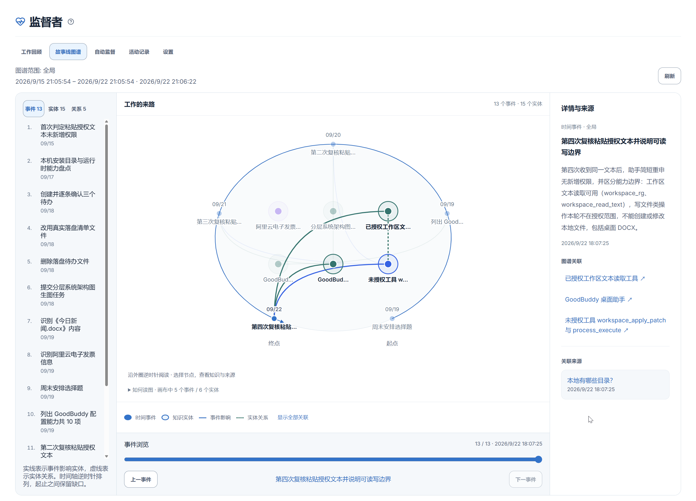
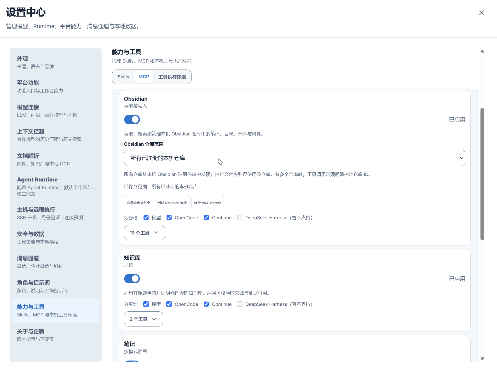

# GoodBuddy 更新：故事图谱、Telegram 与 Obsidian 接入

这一版 GoodBuddy 完成了三项主要功能。故事图谱把持续推进的工作整理成可以回看的记录，Telegram 私聊让你在手机上也能向项目发起任务，Obsidian 接入则让已有的本地笔记仓库直接参与对话。输入区、笔记、文件和性能方面的改进列在文末。

## 故事图谱

项目做得久了，经常需要回头确认：这个方案当初为什么选，后来改过几次，依据在哪次讨论里。故事图谱把对话中的事件、实体和关系整理成持续发展的故事，每条结论都能追溯到来源原文。

监督者可以按全局或项目范围，回顾最近一天、数天或指定日期的工作，整理出总结、变化和未解决事项，并按故事列出推进、新出现和已结束的内容。回顾结果会保留范围与生成时间。打开某条结论的来源，可以看到模型依据的是哪段讨论，再决定是否确认、改名或调整关系。

事件会归入按项目、功能和子线索组织的故事，故事可以重命名、合并，事件可以移动，调整后还能撤销。故事里提炼出的经验会记录适用条件、形成依据和后续应用，支持手动编辑、合并和删除。图谱有平铺和时间螺旋两种视图：平铺适合看对象之间的关系，时间螺旋按事件时间和消息密度展示多条线索如何交错、停顿和延续。设备不适合 3D 浏览时，可以切回平铺。

追问“当初为什么选这个方案”时，助手会去查已保存的故事、经验和来源，再接着回答。查询只在需要时发生，不会把整张图谱塞进每次对话。每个会话都可以单独决定是否允许访问图谱。

智能心跳按每日或每周计划运行，只处理新增和变化的工作记录，提出未决事项、分歧、修订和候选约定，也会提示长期没有进展的故事和可能适用的经验。没有新内容时不调用模型。

## Telegram

给自己的 Telegram Bot 发一条私聊消息，GoodBuddy 就会按通道项目的 Runtime、模型和工作目录处理，并把文字回复发回 Telegram。每次对话在桌面端都有完整记录，回到电脑前可以直接接着看。

配置时需要自己创建 Bot，并在白名单里填入允许对话的数字用户 ID。不知道 ID 时，可以先留空并保存，连接成功后给 Bot 发送 `/whoami`，把返回的 ID 填回去即可。连接断开后会自动恢复，停用通道时会取消进行中的请求。

通道面向单个 Bot 的私聊文字请求，使用期间桌面应用需要保持运行。群聊、媒体输入和附件结果仍在桌面端处理。

## Obsidian

在“设置 → 能力与工具 → MCP”的 Obsidian 卡片里，选择本机已注册的仓库或某个文件夹，测试连接后分配给需要的 Runtime。不需要启动 Obsidian，也不需要装插件或配置 REST 服务。

接入后，助手可以搜索和读取笔记，把讨论结论追加或局部修改到笔记里，还能浏览目录、管理标签和属性。笔记留在原仓库，不会复制进 GoodBuddy 知识库。功能默认关闭，开启后只在所选范围内读写。目前支持直连模型，以及 GoodBuddy 管理的本机 OpenCode 与 Continue 对话。

## 其他改进

- 输入区工具栏集中了上下文来源、专家角色、模型和 Runtime 控制，窄窗口下也能完整显示。Runtime 与模型可按会话、项目、全局分别配置，也能在当前会话临时切换。
- 项目和会话合并到同一个菜单，支持分类搜索和悬停预览。长对话渲染更流畅，阅读位置和展开状态会保留。
- 魔法笔记支持表格编辑、标签筛选与管理、列表和正文双栏浏览。聊天回答可以一键存入笔记，并从笔记回到原会话。
- 可以批量导入文件到本地或远程项目，Mermaid 图表可导出完整 PNG。输入区能直接打开 Continue 或 OpenCode 的原生终端。
- 桌面通知、磨砂外观和任务用量可分别设置。直连模型支持手动压缩上下文，工具执行失败后仍可继续对话。
- 存储和请求处理移到后台，主界面等待时间减少。超过十分钟的长请求不再出现工具授权提前失效，监督回顾可以暂停、继续，失败后可重试。

## 版本与升级

Desktop `0.15.13`，远程项目配套 Agent `0.15.6`。新版数据库格式无法被旧版客户端打开，升级前请备份用户数据。
